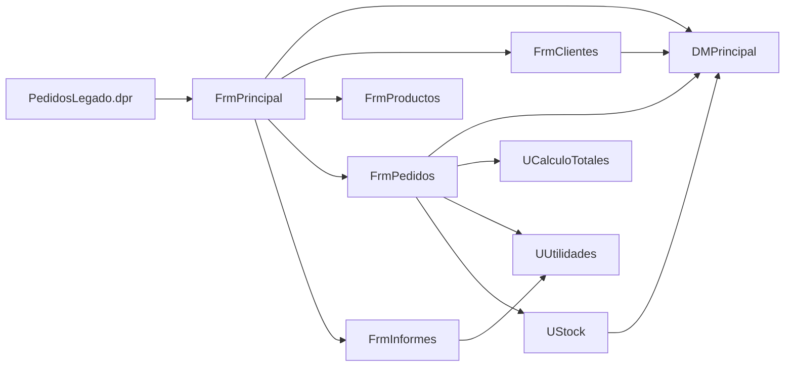
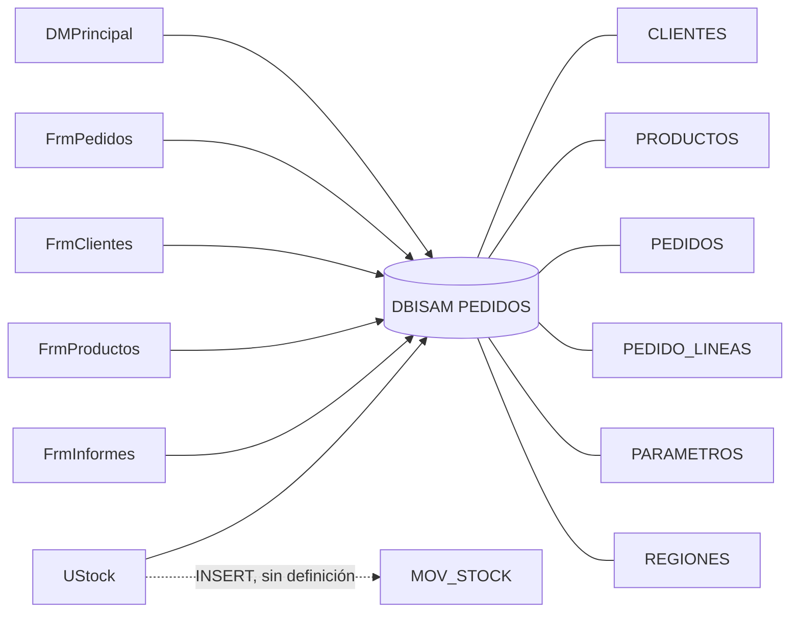

# Dependencias de Pedidos Legado

Una flecha `A --> B` significa «A usa a B»: aparece en una cláusula `uses` o en una consulta SQL o un componente de tabla. Las dependencias se verificaron contra el código en `legado/src/`. Las unidades de la VCL (`Windows`, `Forms`, `DB`, etc.) no se dibujan.

## Diagrama 1: unidades entre sí

`UGlobales` se omite de este diagrama porque lo usan 7 unidades y lo volvería ilegible. Sus aristas están en la tabla de evidencia.

## Diagrama 2: unidades y base de datos

## Evidencia: unidades

| Desde | Hacia | Evidencia |
|---|---|---|
| `PedidosLegado.dpr` | todas las unidades; crea `DMPrincipal` y `FrmPrincipal` | `PedidosLegado.dpr:5-14`, `:21-22` |
| `UFrmPrincipal` | `UDMPrincipal`, `UGlobales`, `UFrmClientes`, `UFrmProductos`, `UFrmPedidos`, `UFrmInformes` | `UFrmPrincipal.pas:38-39` |
| `UFrmPedidos` | `UCalculoTotales` (interface) | `UFrmPedidos.pas:9` |
| `UFrmPedidos` | `UDMPrincipal`, `UGlobales`, `UUtilidades`, `UStock` (implementation) | `UFrmPedidos.pas:67` |
| `UFrmClientes` | `UDMPrincipal`, `UGlobales` | `UFrmClientes.pas:55` |
| `UFrmProductos` | `UGlobales` | `UFrmProductos.pas:36` |
| `UFrmInformes` | `UGlobales`, `UUtilidades` | `UFrmInformes.pas:46` |
| `UStock` | `UDMPrincipal`, `UGlobales` | `UStock.pas:15` |
| `UDMPrincipal` | `UGlobales` | `UDMPrincipal.pas:36` |
| `UCalculoTotales` | solo `SysUtils` | `UCalculoTotales.pas:45` |
| `UUtilidades` | solo `SysUtils`, `DateUtils` | `UUtilidades.pas:25` |
| `UGlobales` | ninguna (sin cláusula `uses`) | `UGlobales.pas` |

## Evidencia: acceso a la base de datos

| Unidad | Tablas | Evidencia |
|---|---|---|
| `UDMPrincipal` | CLIENTES, PRODUCTOS, PEDIDOS, PEDIDO_LINEAS, PARAMETROS (componentes); base `PEDIDOS` | `UDMPrincipal.dfm:11`, `:21`, `:28`, `:35`, `:42`, `:49`; `UDMPrincipal.pas:85` |
| `UFrmPrincipal` | PARAMETROS (vía `LeerParametro`) | `UFrmPrincipal.pas:62`, `:65` |
| `UFrmPedidos` | CLIENTES y REGIONES (JOIN), PRODUCTOS, PEDIDOS, PEDIDO_LINEAS | `UFrmPedidos.pas:101`, `:152`, `:249`, `:259`, `:268`, `:280`, `:285`, `:320`, `:338` |
| `UFrmClientes` | CLIENTES (componente y SQL), PEDIDOS (conteo) | `UFrmClientes.dfm:204`; `UFrmClientes.pas:76`, `:160`, `:207` |
| `UFrmProductos` | PRODUCTOS (componente propio) | `UFrmProductos.dfm:89` |
| `UFrmInformes` | PEDIDOS y CLIENTES (JOIN), con consulta propia | `UFrmInformes.pas:66`; `UFrmInformes.dfm:150` |
| `UStock` | PRODUCTOS, PEDIDO_LINEAS, MOV_STOCK | `UStock.pas:23`, `:51`, `:64`, `:85` |

REGIONES no se abre con componente en `UDMPrincipal`: solo se consulta por SQL desde `UFrmPedidos.pas:101`.

## Preguntas guía

1. **¿Qué unidad usan casi todas las demás? ¿Qué pasaría si cambia?**
   - **Hecho:** `UGlobales` la usan 7 de las 9 unidades restantes: `UDMPrincipal`, `UFrmPrincipal`, `UFrmPedidos`, `UFrmClientes`, `UFrmProductos`, `UFrmInformes` y `UStock`. Contiene variables globales como `gTasaIVA := 0.19;`.
   - **Interpretación:** si cambia un valor o el tipo de una global, el efecto llega a casi todo el sistema sin que el compilador lo avise. Al migrar, esos valores deberían pasar a parámetros explícitos.
2. **¿Qué unidad no depende de formularios ni de la base de datos? ¿Por qué eso importa para migrar?**
   - **Hecho:** `UCalculoTotales` (solo `SysUtils`) y `UUtilidades` (solo `SysUtils` y `DateUtils`) no usan formularios ni acceso a datos.
   - **Interpretación:** son las unidades más fáciles de trasladar a `PedidosWeb.Core`, porque se pueden probar sin base ni interfaz. `UCalculoTotales` además concentra las reglas de totales, así que conviene migrarla con tests primero. Antes hay que resolver las discrepancias de descuento (ver `reglas-negocio.md`).

## Preguntas abiertas

- **Accesos paralelos a la base:** `UFrmInformes`, `UFrmPedidos` (`:278`) y `UStock` (`:63`) crean sus propias consultas con `DatabaseName = 'PEDIDOS'` en lugar de pasar siempre por `UDMPrincipal`. ¿Es intencional?
- **`MOV_STOCK`:** se inserta en `UStock.pas:85` pero no está definida en `esquema-dbisam.sql` ni en los CSV. ¿Dónde se creó?
- **RUT duplicado:** `UFrmClientes` tiene su propia validación (`RutOk`) y no usa `UUtilidades.ValidaRut`, que sí usa `UFrmPedidos` (`UFrmPedidos.pas:91`). ¿Cuál de las dos rige?
- **Cobertura de la verificación:** las dependencias de ejecución dinámicas (por ejemplo `FindComponent` o `Application.CreateForm` fuera del `.dpr`) no se buscaron.
